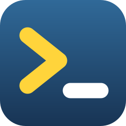
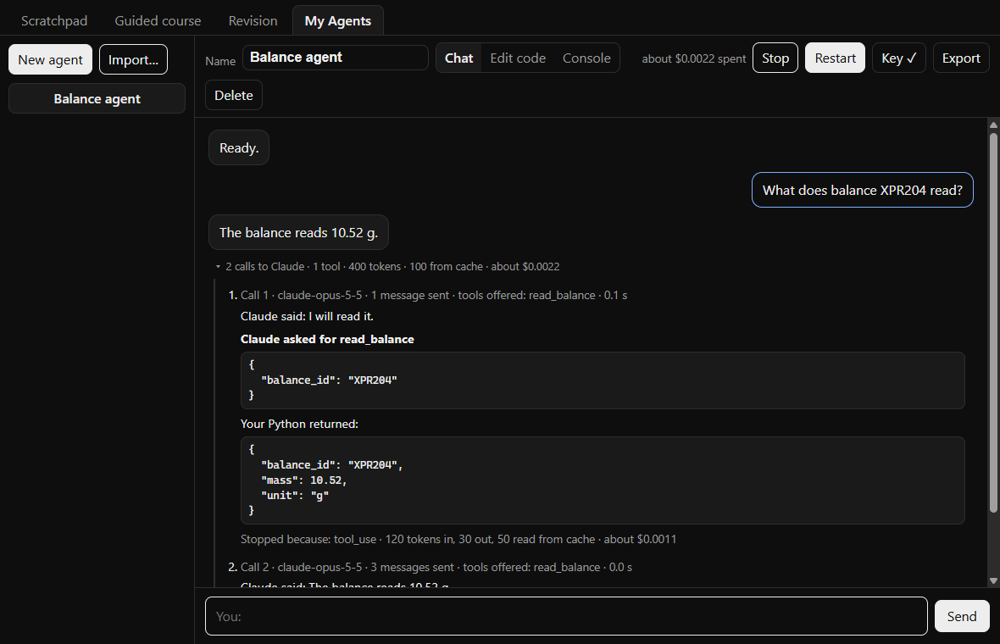
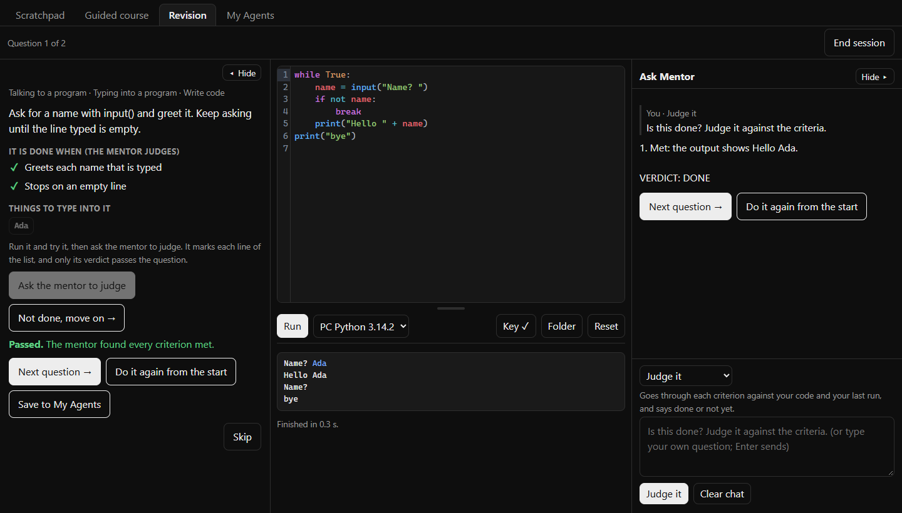
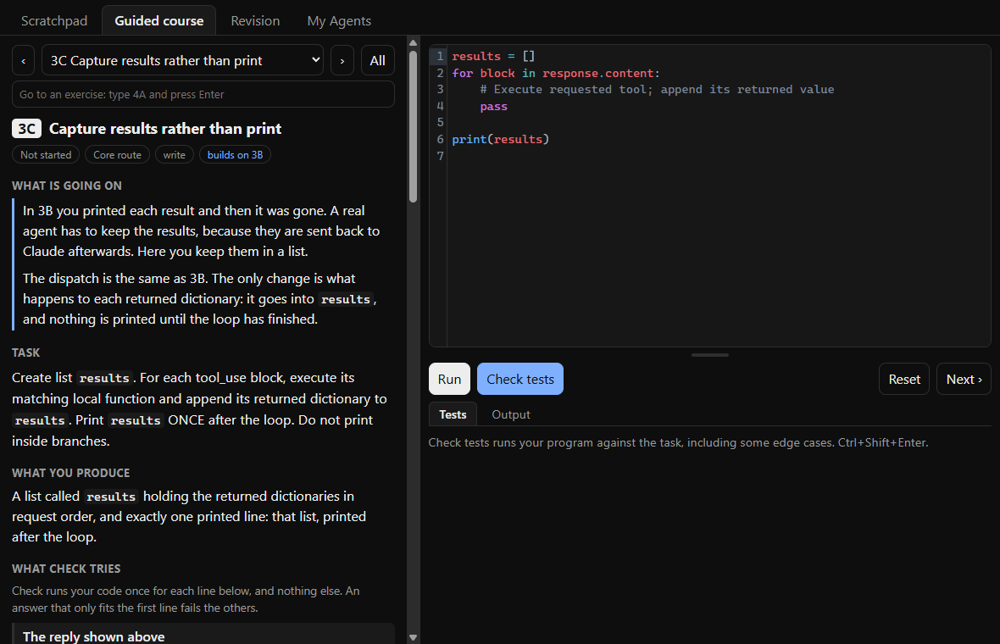
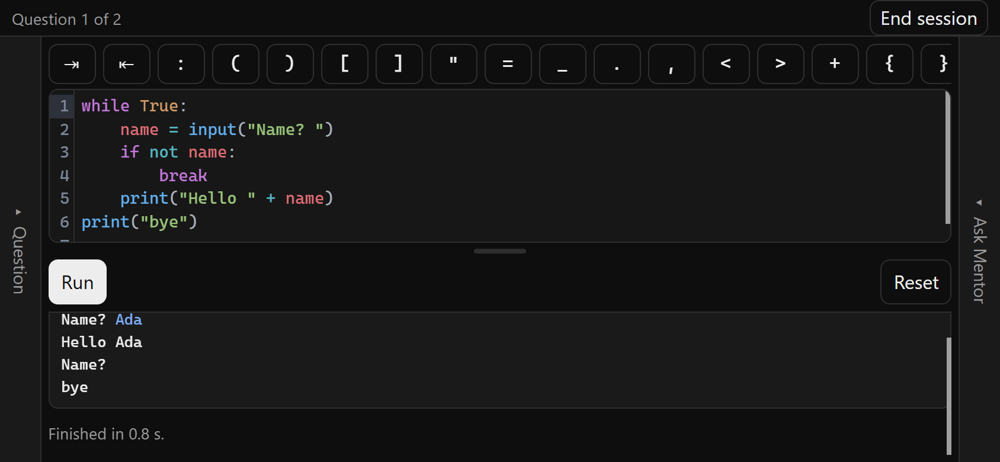

<p align="center"></p>

# Agentwright

A place to learn Python for building AI agents by building them. You write real agent code with the plain Anthropic SDK, a mentor judges it against clear criteria, and what you finish becomes an agent you keep and use as a chatbot. It runs on a Windows PC (the **Python Scratchpad** window) and on an Android phone (the **Python Learning Lab** app), with your own Anthropic API key.

> **Status: early and personal.** This began as one person's study tool and is published as it stands. It teaches agents with Anthropic's SDK specifically. The PC side is Windows only. You bring your own API key and pay for the calls your programs and the mentor make. Code you run in "PC Python", and any agent you import, runs on your PC without a sandbox: read code before you run it.

The idea in one line: **learn, build, keep.** Every exercise ends with working software that is yours, and the agent you chat with tomorrow is the code you wrote today, open to change at any moment.

## What is in it

- **Scratchpad.** An editor and a Run button. Code runs in a bundled Python or, on the PC, in your installed Python with your packages, files and `input()`. Programs can call Claude with your saved key.
- **Guided course.** 70 exercises and a 12-milestone project that take you from tool definitions to a complete agent loop, checked by real tests against simulated laboratory instruments. It runs offline.
- **Revision.** Question sets as single JSON files that anyone, or an AI, can write. Code questions run for real; whole-program questions are judged by an AI mentor against acceptance criteria (done, not yet, or test more). The mentor gives hints, explanations and reviews at the level you choose and never edits your code.
- **My Agents.** Save any program as a named agent and talk to it in a chat view. Open its code whenever you like. A tool-call inspector shows, for each reply, every call to Claude, each tool it asked for, what your Python returned, the tokens used and an estimated cost. Agents export and import as single files.
- **On the phone.** Revision with the mentor, the guided course and a scratchpad, all using the phone's own Python. It also keeps the Python-basics practice this project began as (lessons, spaced review cards, a course map and an optional tutor).

**My Agents:** an agent you wrote, used as a chatbot, with the tool-call inspector open under its reply.



**Revision:** the question on the left, your code and its run in the middle, and the mentor judging it on the right.



**Guided course:** one exercise, with what is going on, the task and what the tests will try.



**On the phone,** in landscape: the same editor and run, with the question and mentor on tabs at the edges.



## Where this is going

- **Learning packs for kinds of agent.** A pack is a guided path to one working agent: a research agent with web search, an agent that keeps notes between conversations, an instrument agent, and so on. Each pack teaches the Python and the agent ideas it needs, and ends with an agent saved in My Agents.
- **Agents that grow with you.** Versions with revert, conversations that survive a restart (as an exercise you write yourself), and saved conversations replayed as tests when the code changes.
- **Sharing.** Revision sets, packs and agents are plain files, made to be passed around, improved and generated.
- **The same on the phone.** My Agents and the inspector in the phone app.

Design notes for My Agents and what comes next are in `docs/my-agents.md`. The rest of this file describes each part as it is built today.

## Python basics practice (phone)

The phone app began as a standalone practice app built from a written brief (called "the brief" below), and that part is still there under **Python basics practice** on its Home screen. Python runs on the phone itself, so these lessons, tests and reviews work with no network and no API key.

- **Continue learning**: one question at a time in Predict, Explain, Fix and Write modes. A wrong answer gets the smallest pointer to the mistake, then Try again, Small hint, Show execution or Reveal solution. Nothing is revealed unless you ask.
- **Writing exercises**: short functions checked by tests, with the history of every attempt.
- **Review**: spaced recall cards (today, tomorrow, 3 days, 7 days, then adaptive).
- **Course map** and **My progress**: evidence per topic as counts, with reading and writing tracked separately and typing slips kept apart from concept misses.
- **Ask the tutor**: with the AI tutor on, type questions about the exercise in front of you, or general Python questions.
- **Settings**: starting point, optional AI tutor, API key, JSON backup export and import.

Seed content: 10 modules, 42 topics, 45 exercises (including the 12 required by the brief), 17 misconceptions and 25 review cards.

## Install on the phone

Build the APK (below), copy it to the phone, then open it and allow installation from that source. It is a debug build signed with the local debug key, so Android will warn that it is from an unknown developer.

## Run on the PC (development)

```
cd app
npm install
npm run dev
```

Then open http://127.0.0.1:5173/. The same app runs in a desktop browser.

## Tests

```
cd app
npm test
```

185 tests. They cover the Python runner, grading, the exercise queue, mastery evidence, the review scheduler, persistence across a restart, backup round-trip and the tutor. Every seeded exercise is run through real Python (Pyodide): each expected output must match, each reference solution must pass its tests, and each broken starter must fail them.

## Build the Android app

```
cd app
npm run apk
```

This builds the web app, copies it into `app/android` and writes a debug APK to `app/android/app/build/outputs/apk/debug/app-debug.apk`. It needs the Android SDK and a JDK 21 or newer; set `LAB_JAVA_HOME` if the script picks the wrong JDK. The SDK location goes in `app/android/local.properties` (`sdk.dir=...`).

The Python runtime (Pyodide) is bundled inside the APK, so the app runs code with no network.

## Python Scratchpad (Windows)

A small window for the PC: type Python, press **Run** (or Ctrl+Enter / F5), and see what it printed or the error. There are no lessons and no tutor in it.

```
cd app
npm run desktop
```

This builds into `desktop/build`, copies the result into a new folder `desktop/app/<timestamp>/`, and points the Desktop shortcut "Python Scratchpad" at it. A scratchpad that is still open keeps running its old version; the next launch from the shortcut is the new one, and old folders are removed once they are no longer in use. It needs the .NET 9 Desktop Runtime (installed with the .NET SDK) and the WebView2 runtime that ships with Windows 11.

The code is kept between launches (in `%LOCALAPPDATA%\PythonScratchpad`). A switch next to Run chooses which Python runs it:

| | Built-in Python | PC Python |
| --- | --- | --- |
| What runs the code | The Python bundled with the app (Pyodide), the same as on the phone | The Python installed on the PC (first `python.exe` on PATH, then the `py` launcher) |
| Packages | Standard library plus the bundled `anthropic` library (no API key on the PC: use PC Python for real calls) | Whatever is installed with `pip`, including `anthropic` |
| `input()` | No | Yes: type in the line under the output while the program runs |
| Files | A throwaway folder inside the app | Real files; programs run in `Documents\Python Scratchpad` (the **Folder** button opens it) |
| Limits | Stopped after 10 seconds; cannot touch the PC | No time limit (use **Stop**); no sandbox |

**PC Python has no safety net.** The code can read, change and delete files and use the network, exactly like a script started by hand. That is the point of it, and it is why the brief's rule against running learner code as a plain process on the host is deliberately set aside here: it is one person running their own code on their own PC. Do not paste code you do not understand into this mode.

**API key for your programs.** In PC Python mode, **Key…** opens a Windows dialog for an Anthropic API key. It is encrypted with Windows data protection (DPAPI) for your Windows account, stored in `%LOCALAPPDATA%\PythonScratchpad\anthropic-key.bin`, and handed to each program you run as the `ANTHROPIC_API_KEY` environment variable, so `anthropic.Anthropic()` finds it and the key never appears in your code. The scratchpad page itself never receives the key. A program you run can read it (that is how it works), so the warning above applies. Calls your programs make are billed to the key; the phone app's daily spending limit does not cover them.

## Guided course (Python & Claude agent curriculum)

The Scratchpad window has two modes, chosen by the tabs at the top: **Scratchpad** (free-form, as above) and **Guided course**. The course began as a written curriculum of 58 exercises with permanent IDs (1A to 9C) in nine modules, plus twelve exercises added here. 3P-A to 3P-F (before 3A) are on who defines what in tool use: Anthropic's message format, the developer's tool definitions and functions, and Claude's choices. 7R-A to 7R-F (before 7A) are on reading Python that appears in real agent code: imports, classes and `self`, tracebacks and exceptions, type hints and f-strings, decorators, and one-line loops. The canonical content is `desktop/curriculum/manifest.json`; IDs are never renumbered, and added exercises get new IDs.

- **Layout:** the task, the fixtures that are already defined, hints and test notes stay visible on the left; the editor, Run, Check tests and results are on the right.
- **Run** (Ctrl+Enter) executes your code with the exercise fixtures defined first and shows the raw output. **Check tests** (Ctrl+Shift+Enter) runs at least one visible test and several hidden edge cases, each in a fresh context, and explains what was observed for each failure.
- **Hints 1 to 3** appear one at a time. **Explain solution** shows a reference solution only when asked. **Reset** returns to the starter for a fresh attempt. **Next** opens the following exercise.
- **Opening an exercise:** pick it from the list, or type its ID ("4A", "open 3c") in the box and press Enter. **Copy exercise context** copies the ID, task, fixture names, your code and the latest test results for pasting to a mentor; anything shaped like an API key is removed.
- **Progress** (code, attempts, hints used, passes) is saved per exercise in `%LOCALAPPDATA%\PythonScratchpad\course-progress.json` and can be exported and imported from the **All** view. A pass counts as "on your own" only with no hint and no solution shown; "secure" needs a second unaided pass at least 20 hours later. A mentor can "mark done" an exercise; that never counts as a pass.
- **Offline and simulated:** exercises run with the PC's Python, need the `anthropic` package installed (`pip install anthropic`) for the SDK fixtures, receive no API key, and have outgoing network connections blocked. Simulated responses are built locally with `Message.model_validate`; nothing contacts Anthropic and no instrument is touched.
- **Limits:** a Run is stopped after 60 seconds and a Check after about 20. There is no memory cap.

All 70 exercises and the 12 project milestones have executable tests. Where a task leaves the shape of the answer open, or its starter only describes code ("given broken dispatcher"), the exercise shows an **In this app** note stating exactly what the tests expect, and any code or fake client the app supplies is listed with the fixtures. The three timed projects (9A to 9C) are small multi-file projects opened as file tabs; Run executes the project's test file or evaluation, and a 55-minute timer is available. They are original practice projects built from the curriculum's contracts. Exercises with a written part (3F, 7F, 8F and the mocks) have an explanation box; it is assessed separately by a rough keyword check that a mentor's judgement overrides. 5G, the optional live run, is checked offline against a fake client and never sends a request.

How it is built: `desktop/curriculum/labcheck.py` runs and checks exercises; `checks_*.py` hold the executable tests (converted from each exercise's acceptance criteria); `workspaces_9.py` holds the timed-project projects; `answer_key_*.py` hold reference solutions and known wrong attempts, kept apart from anything shown in the prompt. `python -m unittest test_labcheck` in that folder (also run by `npm test`) proves that every solution passes, every untouched starter fails, and every recorded misconception is rejected.

### LAB-AGENT: the learner's own agent

Alongside the numbered exercises, the course has a project, **LAB-AGENT** (milestones `LAB-01` onwards). The learner writes one program, `agent.py`, that grows from a chat shell with no Claude in it into a complete tool-use loop. All twelve milestones (LAB-01 to LAB-12) are built.

- **Their code carries forward.** A milestone opens with the code that passed the one before, under a one-line comment naming the new milestone. Until the previous milestone has passed, the next is locked; it can be opened deliberately from a reference version, which is recorded as passed with help.
- **Simulated Claude.** `desktop/curriculum/lab_fake_claude.py` is shown to the learner as a read-only `fake_claude.py`. It is called as `client.messages.create(model=..., max_tokens=..., messages=..., tools=...)`, returns real SDK `Message` objects, and refuses badly ordered histories with errors worded like the API's. It uses no key and no network.
- **Tests judge behaviour.** Each case types scripted lines into the program and inspects what it printed and what it sent to the simulated Claude, so an inline loop and separated functions both pass.
- **Run is a conversation.** For a milestone, Run starts the program and the Output panel takes typed input (up to fifteen minutes).
- **Changes tab.** Shows a line-by-line comparison with the code the milestone started from. Each passed milestone's code is kept in the saved progress and in its export.
- **Checkpoints.** LAB-04, LAB-08 and LAB-12 need a short written account of the flow.
- **Failures.** From LAB-09 the tests script the simulated Claude to ask for an unknown tool or to leave out an argument, and the simulated sensor `TEMP00` raises, so the agent must turn each into an `is_error` result and carry on.
- **Run live (LAB-10 onwards).** The learner's program switches to `anthropic.Anthropic()` only when the environment variable `LAB_AGENT_LIVE` is `1`. Run and Check tests always remove that variable and the key, and block the network. The separate **Run live…** button asks for confirmation each time, then starts the program with the variable set, the saved key as `ANTHROPIC_API_KEY`, and the network allowed (`labcheck.py live`, which refuses exercises not marked for it). The tools remain the simulated instruments in the learner's program. The checks never make a request: in them `anthropic.Anthropic()` is replaced by a recorder.
- **Other versions (LAB-12).** `lab_other_inline.py` and `lab_other_tool_runner.py` are shown as read-only tabs: the same agent as one inline loop, and with the SDK's beta tool runner. They are for reading and are not run.

### The same course on the phone

The phone app has a **Course** tab with the same 70 exercises and 12 project milestones. It runs the PC's own checker (`desktop/curriculum/labcheck.py`, the `checks_*.py` files and the answer key) inside the phone's Python, so a program passes or fails for the same reasons on both. `app/src/course/phone.test.ts` runs every reference solution and every starter through that path.

Differences from the PC:

- **One column.** Task, code, Run and Check, results, then hints.
- **No typed chat.** For the LAB milestones, a box holds the lines you would type, one per turn; Run feeds them to your program and then ends it.
- **No Run live.** The phone course never uses an API key and blocks network connections while exercise code runs, like the PC's Run and Check.
- **No timed-project timer.** The three mocks open and can be checked, but they are meant for the PC.
- **Separate progress.** The phone and the PC each keep their own. **All → Export progress / Import progress** on either side writes and reads the same file, and an import replaces what is there. Because a milestone opens from your own passing code of the one before, a milestone passed on the PC is locked on the phone until that progress is imported.
- **Slower.** Python on a phone is slower than on a PC, so a test case is allowed 12 seconds instead of 3, and Run is stopped after 20 seconds.

Course progress on the phone is stored with the app's settings, so the app's own backup includes it, and **Reset** or importing an older backup in Settings removes it.

`app/src/course/info.generated.json` (which exercises have multi-file workspaces, and their files) is written by `npm run course-info`, which needs Python on the PC; `npm run build` runs it first.

## Revision sets

**Revision** (a third tab in the PC window; **Home → Revision** on the phone) practises question sets written by a mentor, a person or an AI. A set is one JSON file. Paste it into the box (a whole chat reply is fine: the JSON is found inside it) or import it as a file.

- **Four question types.** `recall` (answer from memory, then compare), `choice` (one right option), `predict` (type what the code prints; the app runs the code to get the true answer) and `write` (write code; the app runs the set's tests on it).
- **Questions the learner judges.** A `write` question for a whole program that is talked to, such as an agent with a chat loop, has no `tests` or `output`. It lists `criteria` (what the finished program must do) and optionally `prompts` (lines to type into it; while the program runs with PC Python, clicking one types it). The learner runs it and asks the mentor to judge (see Ask Mentor below), in the PC window and in the phone app alike. Only in a plain browser, where there is no mentor, does the learner tick the criteria and mark it **It does all of this** or **Not done, move on**. The names `acceptance_criteria` and `manual_test_prompts` are read as the same two lists. These questions are not run on import.
- **The format** is described in `MENTOR_INSTRUCTIONS` in `app/src/revision/format.ts`. **Copy instructions for your mentor** puts that text on the clipboard. `app/src/revision/sample-set.json` is a working example.
- **Faulty questions are flagged.** On import, every `write` question's own solution is run against its own tests, and every `predict` question's code is run. A question that fails is marked, so a mistake by whoever wrote the set does not look like the learner's mistake.
- **Repeats.** A right answer comes back after 10 minutes, then a day, 3 days and a week. A miss, or a `write` question passed after showing its solution, starts again and is asked once more at the end of the session.
- **Where it runs.** By default code runs in the Python bundled with the app, on both PC and phone, with no API key. A set's code is run as given, like anything typed into the scratchpad.
- **PC Python in the PC window.** A `write` question there is laid out like the scratchpad: the question in a left panel that can be hidden, a full-size editor, and the output below with the same **Built-in Python / PC Python** switch, **Key…**, **Folder** and input line. With PC Python the code is an ordinary program on the PC, as in the scratchpad: it can call Claude with the saved key (billed to it), use `input()` and installed packages, and has no sandbox. **Check** works in both; with PC Python the tests run at the end of the same program. A question whose code imports `anthropic` or calls `input()` starts on PC Python and is not run when the set is imported, so importing a set never spends money. The phone runs only the bundled Python.
- **Where it is stored.** On the PC, in the window's own storage; on the phone, with the app's settings, so the phone's backup includes it. The two are separate. **Export** on a set writes it back out as a file, without the history, which is how a set moves between them.

### Ask Mentor

A code question in the PC window has a second panel, on the right, that opens from the **◂ Ask Mentor** tab. It is a chat with Claude about the question on screen.

- **What is sent.** Each message carries the exercise (task, existing code, criteria, tests, the lines to type, and the set's reference solution if it has one), the code in the editor at that moment, the output of the last run including errors and test results, any code highlighted in the editor, and the chat so far for this question. Nothing is sent until **Send** or one of the mentor buttons is pressed.
- **Levels.** *Hint only* (the default), *Explain*, *Review my code*, *Judge it* and *Show solution*. The level is a limit on what the mentor gives; only *Show solution* gets working code for the exercise, and using it makes the question come back, like the Show solution button.
- **Judging.** *Judge it*, or **Ask the mentor to judge** beside the question, has the mentor go through each criterion against the code and the output of the last run. It ends with one of three verdicts, shown beside the question: **done**, **not yet**, or **test more** (nothing failed, but something has not been shown by a run; it says what to type). A **done** verdict passes the question: a burst of confetti, then **Next question** and **Do it again from the start**, both beside the question and under the mentor's reply. Doing it again puts the editor back to how the question began and empties the output and the mentor chat (as does **Reset**), and nothing is recorded until Next. Only the mentor's verdict passes such a question: the criteria list shows the mentor's mark against each line (met, not met, not shown) and has no boxes for the learner to tick, and **Not done, move on** records it as not done and goes to the next question. Any run that shows the behaviour counts as evidence, whatever the learner typed; names the exercise fixes, such as dictionary keys and tool names, must match exactly.
- **It cannot change the code.** Replies appear in the panel only.
- **Key and cost.** The call is made by the window's host program with the key saved under **Key…**, using the official Anthropic C# SDK and `claude-opus-5-5`; the page never receives the key. Each message is billed to that key. The mentor does not run anything by itself.
- **Sets without a solution.** A question judged against criteria needs no `solution`. One with `tests` or `output` still does, so that the tests are proven passable on import.

### Revision on the phone

The phone app's Revision works the way the PC window's does, using the phone's own Python and the API key saved in the phone's Settings.

- **Same layout.** A code question fills the screen: editor above, output below. The question and the mentor are panels that slide in over the editor from the left and right edges (the **Question** and **Ask Mentor** tabs) and close again with Hide or a tap outside them. It works in portrait and landscape.
- **Programs that call Claude or wait for typing run on the phone.** Run starts the program in the built-in Python with the saved key as `ANTHROPIC_API_KEY`; output appears as it is printed, and a line under it types into the program when it calls `input()`. Calls the program makes are billed to that key. This needs a current Android System WebView (one that can pause Python for a reply); on an older one the program is told so.
- **The mentor is the judge here too.** It is called from the app with the Anthropic TypeScript SDK, the saved key and `claude-opus-5-5`, is sent the same things as on the PC, and counts towards the daily spending limit in Settings. There is no self-judging on the phone.
- **Not on the phone:** the PC's installed Python, its packages and its files. A question that needs a package the app does not bundle only runs on the PC.

## My Agents (PC window)

The fourth tab of the Scratchpad window. An agent is a Python program the learner wrote, saved under a name and used as a chatbot. Design and later slices: `docs/my-agents.md`.

- **An agent is plain Python.** It reads what is said with `input()` and answers with `print()`. There is no framework and no helper to import, so the code is the same code that would be written anywhere else.
- **Chat.** Start runs the program with the PC's Python, as the Scratchpad does, with the saved key as `ANTHROPIC_API_KEY`; calls it makes are billed to that key. What it prints is shown as the agent's side of a conversation and what is typed as the learner's. The prompt the program prints before `input()` is not repeated in the bubbles. **Console** shows the same run exactly as printed.
- **Tool-call inspector.** Under each reply is a line such as "2 calls to Claude · 1 tool · 400 tokens · about $0.0022". Opening it lists every call the program made for that reply: the model, how many messages were sent, the tools offered, what Claude said, each tool Claude asked for with its arguments, what the program's Python sent back (marked when it reported an error), why Claude stopped, and the tokens used, including any read from or written to the prompt cache. Calls that raised an exception are shown as failed. The agent's code is not changed to get this: My Agents starts the program through `desktop/lab_trace.py`, which wraps the SDK's `messages.create` and `messages.stream` and reports each call on a marked line of stderr that the window reads and never shows as output. Those lines hold no key and no request headers. A streamed reply shows its request only.
- **Spend.** Each call's cost is estimated from its token counts and a price table in the app (cache reads at a tenth of the input price, cache writes at 1.25 times), and added up per reply and per agent ("about $0.02 spent" beside the agent's name). It is an estimate; the Anthropic Console has the real figure.
- **Edit code** opens the program at any time. If it is changed while a conversation is going, the old program keeps running until **Restart**, which starts the new code with an empty conversation. Keeping a conversation across restarts is left to the agent's own code (saving and loading its messages), as an exercise.
- **Getting agents in.** **New agent** starts from a short chat loop; **Save as agent** in the Scratchpad and **Save to My Agents** on a passed live question in Revision copy that program in.
- **Sharing.** **Export** writes one `.agent.json` holding the name, description and code: never the key, never a conversation. **Import** takes such a file or a `.py` file, shows the code with a warning, and adds it only when confirmed, because an imported agent is a program that will run on the PC with the learner's files and key within reach.
- **Where they are kept.** In the window's own storage, like revision sets. Deleting an agent removes it for good unless it was exported.

## The AI tutor and your API key

The tutor is off until you save a key in Settings and switch it on.

- Type the key into **Settings → AI tutor** on the phone. It is stored in Android's Keystore-backed secure storage. It is never written to the database, a backup, a log, this repository or the APK.
- In a desktop browser the key is kept in that browser's storage without protection. Use a throwaway key there, or none.
- Never put a key in a file in this repository. `.env` files are ignored by git as a second guard.
- "Check key and model" confirms the key and the model with the Models API without spending tokens. The model id is a setting (default `claude-opus-5-5`).
- Each request sends the exercise, your answer and the check result. No history is sent.
- Spend is estimated from token counts and capped by a daily limit (default $0.50). At the limit, or offline, the built-in feedback takes over.
- Predictions and code are always graded by real Python on the device. Claude words the hint and grades written explanations. A hint that contains the expected output, the correct option or a line of the solution is discarded.
- For models that support it, requests opt into Anthropic's server-side refusal fallback (`fallbacks: "default"`).

This differs from the brief, which keeps the key on a backend. A standalone phone app has no backend. That is acceptable for one person's key on their own phone; a distributed app would need a server-side proxy.

## The anthropic library in the built-in Python

The built-in Python (phone scratchpad, and the desktop scratchpad's Built-in mode) bundles `anthropic` 2.6.0 and what it needs, about 5 MB, so `import anthropic` works with no download.

- A scratchpad program that imports `anthropic` is treated as a network program: the library is loaded on first use (a few seconds), the time limit becomes three minutes, and a **Stop** button is shown.
- On the phone the key saved in **Settings → AI tutor** is handed to the program as `ANTHROPIC_API_KEY` for that run only, so `anthropic.Anthropic()` finds it. A program you run can read the key; that is how it works.
- These calls are billed to your key. The tutor's daily spending limit does **not** cover them, and they are not counted in "Today".
- Use the ordinary client (`anthropic.Anthropic()`), not `AsyncAnthropic`. Output appears when the program ends, including streamed replies.
- Real calls need a browser component that can pause Python while it waits for a reply (Android System WebView / Chrome 137 or newer). On an older one the library still imports, and the scratchpad says that calls cannot be made.
- The packages are listed with their SHA-256 in `app/scripts/py-packages.json`. `npm run copy-pyodide` downloads them once into `app/vendor/pypackages` and refuses any file that does not match.
- Browsers only allow calls to the Anthropic API when the request carries the `anthropic-dangerous-direct-browser-access` header. The runner adds it to requests for `api.anthropic.com` only.
- Exercises, tests and review do not use any of this: they run offline as before.

## Differences from the brief

| Brief | This build | Reason |
| --- | --- | --- |
| FastAPI server on the PC | None | A phone app must work with the PC off |
| SQLite | IndexedDB on the device, plus JSON export/import | No server to host SQLite |
| Seed data as JSON/YAML | Typed TypeScript modules, exported as JSON in backups | Multi-line code is readable and type-checked |
| Stored Mastery table | Derived from the attempt log and review history | One source of truth; nothing to drift |
| Key held by backend | Android secure storage | See above |

## Known limitations

In rough order of importance:

1. **The AI tutor is only partly verified live.** Hints after a wrong answer were confirmed working on the owner's phone with a real key (11 Nov 2026). Real API calls from a scratchpad program (built-in Python) reached Anthropic's API in a desktop app window with a dummy key (answer: invalid key), but have not been run with a real key or on a real phone; the test emulator's WebView (Chrome 124) is too old for them. Asking the tutor questions, grading of written explanations, "Try a variant (AI)", the daily spending limit and the refusal fallback have only been tested against a stand-in client. Tutor conversations are not saved once you leave the screen.
2. **Runner isolation is not a hardened security boundary.** Code runs in Pyodide inside a Web Worker with a five-second limit, an output cap and a fresh working directory per run. That is suitable for your own exercises, not for untrusted code. Packages outside the Python standard library are not available.
3. **Explanations are graded by keywords when the tutor is off.** You can overrule the result with "I had the idea, worded differently".
4. **Debug build only.** There is no release signing; installing a build signed with a different key needs an uninstall first, which removes app data. Export a backup before that.
5. **Android only.** An iPhone build needs a Mac.
6. **No guided line-by-line editor.** The brief suggests one for phones; there is one full editor with a row of symbol keys.
7. **Import replaces all data.** There is no merge.
8. **Content editing is limited to review cards.** Lessons and tests are edited in `app/src/content`.
9. `input()` is not supported in exercises.
10. **The Course tab has not been tried on Android.** It was tested in a phone-sized desktop browser (Edge, 12 Nov 2026) and by the automated tests, not on a phone or the emulator. How long the first Check takes on a real phone is not measured.

## Not built yet

- Brief phase 4: the Claude response inspector mini-project and the tool-use lessons. Their topics are on the course map as "later", including the append-once-before-the-loop bug as a planned debugging exercise.
- Brief phase 5: evals.
- An in-app lesson editor, and import of transcript-derived cards.

## Screenshots

Beyond the four near the top of this file, `docs/screenshots/` holds earlier captures: 01 to 10 are from an Android 15 emulator in airplane mode and show the Python-basics practice, and 11 to 13 are the PC window.
